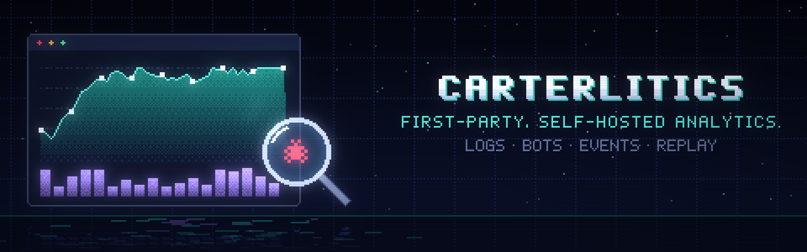

# carterlitics

First-party, self-hosted analytics for a handful of sites: who visits, which bots crawl,
what breaks, and (with consent) what a visit looked like. One collector serves every
site, so cartercole.com and cartercole.net share the code, the storage and the console.

- **Server side, every request.** CloudFront's access logs flow into the collector, so
  every page request is counted, cache hits included: people, crawlers, AI bots,
  scanners probing `/wp-login.php`, feed readers. Each comes with its IP, user agent,
  country, network and reverse DNS name, and with what the address is: an ISP, a
  datacenter, iCloud Private Relay, a VPN, Tor, a crawler's own range, or a known attacker.
  A request that says it's Googlebot (or Bingbot, GPTBot, Applebot, …) is checked
  against the crawler's published ranges and forward-confirmed DNS, so fakes show up.
- **Client side, one script.** `/_c/c.js` counts page views (SPA navigations too),
  engaged time, unique visitors and visits (cookieless, a daily-salted hash), with bounce
  rates, landing and exit pages, where visits came from (sources, channels and UTM
  campaigns), custom events (`cl("track", …)`, awaitable), and
  JavaScript errors: uncaught, unhandled rejections,
  failed resources, CSP violations, grouped by bug. Google Analytics calls (`gtag()`,
  `dataLayer.push()`, `ga()`, `_gaq.push()`) are understood too, so a page written for
  Google works unchanged.
- **With consent, more.** A visitor cookie, a session, a device fingerprint, the IP and
  user agent per page view, and an rrweb session recording you can replay.
- **Funnels.** Steps in order (pages, events, a backend's events), counted over consented
  sessions or visitors, with drop-off per step and replays of the sessions that stopped.
- **Google Search.** Clicks, impressions, CTR and position from Search Console, by day,
  query, page, country and device, with sitemaps, for each site's own hosts. A Google
  service account reads it, and the collector reaches that account with no stored key.
- **One console** at `/_c/admin/`: overview, traffic, search, bots, visitors and sessions,
  events, funnels, errors, replays, for every site. Click any address for everything
  known about it, its registry record (RDAP) included.

Stdlib Python on Lambda (no dependencies beyond the runtime's boto3), one DynamoDB table,
two S3 buckets. No build step for the browser side.

```
carterlitics/        the collector (a Python package; Lambda handler carterlitics.app.lambda_handler)
  app.py             routes: beacons, static files, the console and its API, S3 log events
  store.py           every read and write, and the key layout (see its docstring)
  classify.py        bots, browsers, page paths, referrers and sources, datacenter networks
  logs.py            CloudFront access logs (v2 JSON or W3C) -> records
  geo.py             a pure-Python .mmdb reader: IPinfo Lite, GeoLite2 Country/City/ASN
  intel.py           what an address is: reverse DNS, published ranges, crawler checks, RDAP
  google.py          Search Console, as a service account: AWS -> Google federation, the reports
  auth.py            console sign-in: OpenID Connect + PKCE, admins only; server keys
  config.py          sites, retention, secrets
  backends.py        DynamoDB and S3, and in-memory twins for tests and dev
  dev.py, demo.py    the local server, and 30 days of fake traffic (and funnels) for it
  static/
    c.js             the client
    console.*        the console; replay.* the player page
    vendor/          rrweb 2.2.0 recorder and player (MIT)
carterlitics.toml    the sites, retention, sign-in, and [aws] names
infra/deploy.py      provision, ship, route, enable logging (AWS CLI, idempotent)
tests/               python3 -m unittest discover tests (client_harness.js: c.js under node)
```

## How it fits together

```
                       ┌──────────── cartercole.com's CloudFront ──────────┐
browser ── /_c/c.js ──►│  /_c/c.js, /_c/s/*   cached (CachingOptimized)     │
        ── /_c/i ─────►│  /_c/*               uncached, + x-origin-verify,  │──► Lambda carterlitics
        ── /_c/r ─────►│                      x-carterlitics-site headers   │       │  (Function URL)
                       └──────────── access logs (v2, JSON) ───────────────┘       │
                                         │                                         ├─► DynamoDB carterlitics
                       ┌── every other site's CloudFront, the same ──┐              │     counters, logs, sessions,
                       └─────────────────────────────────────────────┘              │     error groups (TTL)
                                         ▼                                         ├─► S3 carterlitics-<account>
                          S3 carterlitics-<account>-logs ── ObjectCreated ─────────┘     rec/<site>/<session>/
```

Every site routes `/_c/*` to the same Function URL. CloudFront adds two headers: a
shared secret (`x-origin-verify`, without which the collector answers 403) and the
site's id (`x-carterlitics-site`). Viewers can't forge either, since CloudFront overwrites a
viewer's header of the same name. Being on each site's own origin keeps everything
first-party: cookies are the site's, CloudFront supplies the real viewer address,
country and ASN, and blockers that target third-party analytics hosts don't apply.

## What is collected

| | When | What | Kept |
|---|---|---|---|
| Server requests | always | IP, user agent, method, path, query, status, referrer, country, network, reverse DNS name, kind of connection, crawler verdict, edge result. Assets (`.js`, `.css`, images, fonts) are skipped; feeds, sitemaps and `robots.txt` are kept | 30 days |
| Page counters | always, unless DNT/GPC | daily counts per page, country, device size, browser, OS, kind of connection; views whose browser clock is in another time zone than the address; engaged (visible) time per page; bots that run JS are counted apart | 400 days |
| Unique visitors | always, unless DNT/GPC | `sha256(daily salt, site, IP, UA)`; the salt is random and deleted after 2 days, so hashes can't be reversed afterwards | 400 days (as a count) |
| Visits | always, unless DNT/GPC | daily counts of visits, bounces, landing and exit pages, and where visits came from: source, channel, campaign. The visit in progress is one item per visitor hash: when it was last seen, how many page views and events, its first and latest page, its source; no address or user agent (`v\|<site>\|<hash>`) | 400 days (as counts); the item a day |
| Events | always, unless DNT/GPC | name, properties (≤ 2 KB), page | 180 days |
| Errors | always | message, type, stack, source, page, user agent; no identifier unless consented | 90 days |
| Consented visits | consent only | visitor cookie (`vid`), session, fingerprint, IP, UA, geo (city and region too), reverse DNS name, kind of connection, browser time zone, per page view | 400 days |
| Address names | with the above | an address's reverse DNS name, as a cache (`ip\|<address>`) | 7 days |
| Recordings | consent only | rrweb: DOM, mouse, scroll; inputs masked, `[data-private]` blocked, `[data-mask]` text masked | 30 days |

Retention is `[retention]` in `carterlitics.toml`; everything expires through the table's
TTL or a bucket lifecycle rule. A site with `server_ip = "truncate"` keeps server-log
addresses at /24 (IPv4) and /48 (IPv6). Query strings in the request log have the values
of credential-like parameters (`code`, `state`, `token`, signatures, …) replaced, since
OAuth callbacks carry them.

### Visits, bounces and exits

A **visit** is one visitor's page views and events with no gap longer than 30 minutes.
Visits are counted on the collector from the same daily hash as unique visitors, so they
need no cookie and count everyone who isn't opted out, consented or not. Every tab of a
browser is part of the same visit. A visit ends early at midnight UTC (the salt
changes) and when the visitor's address does (a phone leaving Wi-Fi).

- **Bounce rate**: the share of visits with one page view or event. An event counts as
  the visitor doing something, so opening a modal or clicking a link out isn't a bounce;
  an event with `non_interaction: true` (Google's flag, which c.js carries over) doesn't
  count, nor does leaving the page. Per landing page too.
- **Exit pages**: where each visit was last seen, and the **exit rate**, the share of a
  page's views that were a visit's last. Rates use only the days visits were counted,
  so the days before this was deployed don't pull them down.
- **Pages per visit**: page views over visits, on the Overview's Visits tile.

The counters are kept true as a visit goes on, rather than worked out afterwards: a visit
counts as a bounce until its second page view or event, and as an exit from the last page
it was seen on. A report is still a handful of queries.

**Consented sessions** (the Visitors tab, recordings, funnels) are one tab's, kept in
`sessionStorage`, and end the same way: after 30 minutes without a page view or event,
the tab's next one starts a new session, and a running recording carries on under it from
a fresh snapshot of the page. They are per tab rather than a cookie because each is one
recording. Each session row shows the page it landed on, the page it left from, and where
it came from.

### Where visits came from

A visit is counted by where it came from when it begins, from its first page view's
referrer and the campaign tags on its address:

- **Source**: the link's `utm_source` (or `ref`), otherwise the site it was on, grouped by
  who that is: google.co.uk, images.google.com and the Google app are all *Google*,
  mail.google.com is *Gmail*, t.co is *X*. A site `classify.SOURCES` doesn't know is its own
  host, and no referrer is *Direct*. A `utm_source` that names a known source (`google`,
  `hn`, `chatgpt.com`, which ChatGPT adds to its links) counts as that source.
- **Channel**: the kind of source, Google Analytics' default grouping simplified, with AI
  assistants apart: Search, Social, Email, AI assistants, Referral, Direct, and Paid search,
  Paid social or Paid other when `utm_medium` says paid (`cpc`, `ppc`, `paid…`, `display`)
  or the address carries an ad network's click id (`gclid`, `msclkid`, `twclid`, …;
  `fbclid` is on every link Facebook opens, so it isn't one). For a source it doesn't
  know, `utm_medium=email` or `social` decides.
- **Campaign**: `utm_campaign`.

```
https://cartercole.com/posts/x?utm_source=newsletter&utm_medium=email&utm_campaign=november-notes
```

Tags are trimmed and lower-cased, so `Newsletter` and `newsletter` count once. c.js sends
only these four tags and the name of a click id, never its value. Each source, channel and
campaign has a bounce rate, on the Overview. A visit that restarts at midnight UTC or on a
new address (above) counts as Direct, since its next page's referrer is the site itself.
Visits are counted this way from the deploy that added it; when a range starts earlier, the
cards say from when. The page-view referrer counts kept before then are no longer shown.

## The sites

`carterlitics.toml` lists cartercole.com and cartercole.net (script, consent banner,
recordings), the project sites under cartercole.net (script in anonymous mode: they have
no banner, so page views, events and errors, nothing identifying), and four hosts counted
from CloudFront's logs alone (`client = false`): the account hub, the power app, and the
two `*.` catch-all redirects. A site is matched to its distributions by host name, so
`resume` covers both resume.cartercole.net and resume.cartercole.com.

The two main sites have funnels. cartercole.com's events come from its
`frontend/src/lib/track.ts` (`post_read`, `outbound`, and sign-in as `login_view`,
`login_start` and `login`, since `/auth/*` isn't counted as pages); cartercole.net's from its
`static/modal.js` (`dossier_open`, `shot_open`, `outbound`). Each funnel's comment in
`carterlitics.toml` names the properties.

**Bots** are recognised by user agent (about 150 named crawlers and tools, by kind: search, AI,
social, SEO, monitoring, feeds, scanners, automation and HTTP libraries), by asking for
something only a scanner wants (`.php`, `/.env`, `/.git/`, `/wp-…`), by sending no user
agent or a non-browser one, by coming from a Spamhaus DROP network, and, for scripts
that run, by `navigator.webdriver`. A browser user agent from a hosting network (AWS,
GCP, Azure, DigitalOcean, Hetzner, …) is flagged "datacenter" rather than called a bot,
since it may be a VPN.

### What an address is

`intel.py` answers this for every address the collector keeps, without sending it to
any lookup service:

- **Reverse DNS**: the name its owner gives it (`c-73-22-1-9.hsd1.il.comcast.net`,
  `crawl-66-249-66-1.googlebot.com`), from AWS's resolver, cached a week. Its domain
  is counted too (Traffic: *Host domains*), which names companies with their own
  networks as well as ISPs. Only addresses that are stored anyway are looked up: server
  logs, consented visits, and backend events that carry an IP. A site with
  `server_ip = "truncate"` gets none, since the names spell the address out.
- **Published ranges**, built into `geo/ranges.bin` by `infra/deploy.py intel` from
  about thirty public lists: the ranges Google, Bing, OpenAI, Perplexity, Apple,
  DuckDuckGo, Common Crawl, UptimeRobot and Pingdom crawl from; AWS, Google Cloud,
  Azure, Oracle, Cloudflare, Fastly, DigitalOcean, Linode, Vultr and GitHub Actions;
  iCloud Private Relay's egress; Tor exits; Mullvad's servers and other VPN providers'
  networks (X4BNet); datacenters (X4BNet); Starlink; Spamhaus DROP; and addresses seen
  attacking in the last days (blocklist.de, DShield). One binary search per address,
  about 4 µs. Each record gets a *connection* (`isp`, `hosting`, `relay`, `vpn`, `tor`,
  `crawler`) and the most specific name the lists give ("AWS EC2 us-east-1"). Private
  Relay is told apart from the Akamai and Cloudflare networks it rides on, which used
  to be flagged as datacenters.
- **Crawler checks.** A request that names a crawler with a published way to verify
  it is marked `verified` (its address is in the crawler's published ranges, or its
  reverse DNS name is the crawler's and resolves back to it, or it comes from the
  crawler's own network) or `spoofed` (a check that could pass didn't). Spoofed requests
  are counted as "Googlebot (fake)", kind "impostor". facebookexternalhit isn't checked:
  iMessage sends it from people's phones.
- **Clocks.** c.js sends the browser's time zone. When it keeps a different time from
  the address's (CloudFront's `CloudFront-Viewer-Time-Zone`, or GeoLite2 City), the view
  counts as *clock elsewhere*: a traveller, or a VPN in another country.
- **The registry**, on request: clicking an address in the console asks RDAP (ARIN,
  which redirects to the registry that holds the block) who holds it, its range, and
  its abuse contact. This sends the address to the registry, so it only happens when
  you click.

## Using it on a site

1. Add the site to `carterlitics.toml` (`id`, `url`, `aliases`, `exclude`, `dev_url`) and
   re-run `infra/deploy.py provision`.
2. Put the script and a banner in the page layout:

   ```html
   <script async src="/_c/c.js"></script>

   <!-- c.js shows this if the visitor hasn't chosen, and hides it when they do -->
   <div data-consent hidden>
     <p>… what you collect, a link to /privacy …</p>
     <button type="button" data-choice="essential">Anonymous only</button>
     <button type="button" data-choice="all">Accept</button>
   </div>
   <button type="button" data-consent-reopen>Privacy choices</button>
   ```

   Style the banner however the site looks; only the data attributes matter. Without a
   banner the script stays anonymous: `<script async src="/_c/c.js"></script>` alone is a
   complete install.
3. `infra/deploy.py routes <site>` and `infra/deploy.py logging <site>`.

Script options (attributes on the tag): `data-mode="consent"` (default) · `"full"`
(identify without asking: an internal tool) · `"anonymous"` (never identify, no
banner); `data-record="off"`; `data-errors="off"`; `data-exclude="/admin,/auth"`;
`data-google="off"` (ignore Google Analytics calls); `data-datalayer="name"` (gtag.js or
GTM was given another name for its queue); `data-consent-version="2"` (see below).

**When Accept comes to cover more**, raise `data-consent-version` (it starts at 1).
Visitors who accepted under an earlier version see the banner again, and until they
choose they're anonymous. Their visitor cookie is kept, so accepting again continues
where they were. "Anonymous only" stands, since nothing changes for those visitors. The
`consent` cookie records the version it was given under (`all.2`). cartercole.com is at
2: Accept now also covers a signed-in visitor's account ID.

Every consented record (session, page view, event, error) keeps the version it was
accepted under (`cv`), so you can show which policy a visitor agreed to. Each version's
policy should stay published. Set `consent_docs = "/privacy/v{version}"` on the site and
the console's sessions link to it. cartercole.com keeps its versions in
`frontend/src/lib/consent.ts`, which also supplies the banner's text and the script's
`data-consent-version`, and publishes each at `/privacy/v<n>`.

### From JavaScript

```html
<!-- optional: lets you call cl() before c.js has loaded -->
<script>window.cl=window.cl||function(){(cl.q=cl.q||[]).push(arguments)}</script>
```

```js
await cl("track", "download", { file: "mosaic.zip" });  // resolves once it's sent
cl("track", "seen", { non_interaction: true });         // counted, but not as the visitor doing something
cl("error", err, { where: "checkout" });                // a caught error, reported anyway
cl("page");                                              // a page view by hand (pushState is automatic)
cl("consent", "all");                                    // what the banner's buttons do
cl("identify", "user-123");                              // tie a consented visitor to your user id
cl("identify", null);                                    // signed out: forget it
const who = await cl("who");                             // what the collector makes of this visitor
carterlitics.flush();                                    // send what's queued now
```

`cl("identify")` only applies to a visitor who accepted. An id given before that is
kept in memory and used if they accept on that page. It lasts for the tab's session, so
call it with `null` when they sign out. cartercole.com sends its `provider:id` account
ID from `frontend/src/lib/account.ts`.

### What the collector makes of a visitor

The bot and connection checks the console shows are there for the page too, when it asks:

```js
cl("who", function (who) {   // works through the stub; once loaded, cl("who") is also a Promise
  if (!who) return;          // the collector couldn't be reached
  if (who.bot && who.bot.verified !== true) hideTheForm();   // a bot, or a crawler that isn't who it says
  if (who.net === "tor" || who.listed || who.abuse.length) askForMore();
});
```

```js
{
  bot: null,                 // or { name: "Googlebot", category: "search", verified: true },
                             // verified: true / false (an impostor) / null (can't be checked)
  net: "vpn",                // isp · hosting · vpn · relay (iCloud Private Relay) · tor · crawler
  service: "Mullvad",        // the most specific name the lists give, or ""
  listed: false,             // on Spamhaus DROP (then bot is "Spamhaus DROP" too)
  abuse: [],                 // the attack lists that name the address: "blocklist.de", "DShield"
  elsewhere: true,           // the browser's clock keeps another time than the address's (null: unknown)
  country: "DE", asn: "39351", network: "31173 Services AB"
}
```

It's `GET /_c/who`, sent only when the page asks and once per page load. Nothing is
stored or counted, so it answers with Do Not Track too. The address and its reverse DNS
name aren't in the answer. The address is only looked up in DNS when the user agent
claims a crawler that its address alone can't prove (Yandex, Baidu, a Googlebot outside
Google's published ranges). A bot that doesn't run JavaScript never asks, so this
catches the ones that do: headless browsers (`navigator.webdriver`), crawlers that
render pages, and scripts on hosting networks or proxies.

### Google Analytics calls

A page written for Google Analytics needs no changes: c.js hears Google's calls, whether
or not Google's own script is still on the page, and Google (if it is) sees them too.
Each event becomes a carterlitics event named the way GA4 names it, the action, with the
older category, label and value as GA4's `event_category`, `event_label` and `value`:

```js
gtag("event", "sign_up", { method: "google" });            // gtag.js (GA4)
dataLayer.push({ event: "sign_up", method: "google" });     // Tag Manager; gtm.* events are skipped
ga("send", "event", "Videos", "play", "intro", 3);          // analytics.js -> play {event_category, event_label, value}
_gaq.push(["_trackEvent", "Videos", "play", "intro", 3]);   // ga.js, the "asynchronous" snippet: the same
```

- **Page views.** `gtag("event", "page_view", { page_path })`, `ga("send", "pageview", path)`
  and `_gaq.push(["_trackPageview", path])` count one, unless it's the page already
  counted (c.js counts every page and `pushState` itself, so a bare `page_view` adds nothing).
- **User ids.** A `user_id` given to `gtag("config" | "set", …)` or a `userId` to
  `ga("create" | "set", …)` is `cl("identify", …)`: it applies only after consent.
- **Calls made before c.js loads** are read from Google's own queues (`dataLayer`, `ga.q`,
  `_gaq`), so Google's snippet doubles as the stub. Without it, c.js defines `gtag()`,
  `ga()` and `_gaq` itself; `data-google="off"` stops all of this.
- **Callbacks.** `event_callback`, `eventCallback` and `hitCallback` (often a navigation)
  run once the event is sent, or after `event_timeout` (2 s by default), when Google's
  script for that API isn't on the page. When it is, Google runs them. Never twice.
- **Names.** Event names are letters, digits, `_ . : -` and spaces, up to 64 characters;
  anything else becomes `_` inside a name and is dropped at its ends (`open/close` ->
  `open_close`). Object and array parameters (GA4's `items`) are kept as JSON text.
- **Not carried over:** Google's own automatic events (enhanced measurement, scrolls,
  outbound clicks), `config` page views (c.js counts its own), consent mode, ecommerce
  plugin calls (`ga("ec:…")`), and functions pushed onto `_gaq` or `ga()`.

### Funnels

A funnel is steps in order. Each site lists its own in `carterlitics.toml`, under the
site's `[[site]]` table:

```toml
[[site.funnel]]
name = "Sign-up"
by = "session"            # or "visitor": across sessions, by the visitor cookie
steps = ["/", "/pricing", "event:begin_checkout", "event:sign_up?plan=pro"]
```

| Step | Matches |
|---|---|
| `/pricing` | a page view of `/pricing` (`/pricing/` and `/pricing.html` count as it) |
| `/blog/*` | a page view of anything under `/blog/`; `*` matches anything, `/` included |
| `event:sign_up` | an event of that name, from the page or from the site's backend; `*` works here too |
| `event:sign_up?plan=pro&trial=true` | ... whose properties have these values |

A new or changed funnel goes live with `infra/deploy.py provision`, which hands the
Lambda its configuration (`code` ships only the code).

The Funnels tab shows, for each, how many sessions (or visitors) reached each step, the
share that went on, the median time between steps, and links to replay recent sessions
that stopped at a step. Below them, *Try a funnel* counts any steps you type, without a
deploy; the URL keeps them, so a link shares one.

How a journey is matched: the first page view or event that matches step 1, then the
first one after it that matches step 2, and so on; whatever else happens in between
doesn't matter. Items in one batch from c.js keep the order they happened in.

- **Consented visitors only.** Funnels are read from the page-view and event logs, and
  only a consented visit carries a session there. An anonymous page view isn't logged one
  by one at all, and an anonymous event has nothing to tie it to the page before it. On
  a site in `anonymous` mode, funnels stay empty.
- **Backend events join by user id.** An event POSTed to `/_c/server/events` with a `uid`
  joins the latest session (or visitor) that had sent that user id (`cl("identify")`)
  and had begun by then.
- **Cost.** Opening the tab reads that site's page-view and event logs for the range (up
  to 90 days, two queries per day) and counts in the Lambda; nothing is precomputed.

Events and errors are batched for a second, then sent with `fetch(keepalive)`, or
`sendBeacon` when the page is going away.

### From a site's backend

```bash
curl -X POST https://cartercole.com/_c/server/events \
  -H "x-carterlitics-key: $(AWS_PROFILE=carter-admin infra/deploy.py server-key cartercole.com)" \
  -d '{"events":[{"name":"signup","props":{"via":"google"},"uid":"user-123","ip":"203.0.113.9","ua":"Mozilla/5.0 …","path":"/auth/google"}]}'
```

The key is derived per site from one secret, so a leaked key only speaks for its own site.

## Search Console

The Search tab shows what Google's search does for a site: clicks, impressions,
click-through rate and average position per day, and the queries, pages, countries and
devices behind them, with the sitemaps submitted for its hosts and when Google last read
them. It comes from Search Console's API, asked when you open the tab and kept a quarter
of an hour.

- **One account reads it all.** A Google service account (`[google]` in
  `carterlitics.toml`: carterlitics@carterlitics.iam.gserviceaccount.com) needs read access
  to one *domain property* per domain, `sc-domain:cartercole.net` and
  `sc-domain:cartercole.com`, and every site under them is covered.
- **Each site is its own hosts.** A domain property counts every host under the domain,
  so a site's numbers are filtered to its pages (`mosaic.cartercole.net` is mosaic's
  alone, `cartercole.net` leaves the subdomains out). A site under two domains
  (resume.cartercole.net and .com) adds both together. A catch-all (`*.cartercole.net`)
  has no pages of its own, so it shows none. Google counts by page when filtered, so
  these totals can be a little above the property's own in Search Console.
- **No key.** On Lambda the collector signs in to Google as its own AWS role, through a
  workload identity pool whose one provider admits only that role in this AWS account,
  and then acts as the service account (`GOOGLE_AUDIENCE`). Nothing secret is stored. The
  dev server acts as it through gcloud's application default credentials, which the
  person who ran `search-console` may do; `--demo` makes its numbers up.
- **Google is behind.** Its numbers arrive two or three days late and are counted in
  Pacific time. The tab says what its newest day is.

Setting it up, once (the Google steps run as gcloud's application default credentials,
`gcloud auth application-default login`, with rights to create projects in the
organization):

```bash
AWS_PROFILE=carter-admin infra/deploy.py search-console --dry-run   # what it would do
AWS_PROFILE=carter-admin infra/deploy.py search-console    # project, account, pool, provider, who may act as it
AWS_PROFILE=carter-admin infra/deploy.py provision         # hands the function GOOGLE_AUDIENCE and the account
```

Then give the account read access to each domain property, one of two ways:

- **In Search Console** (no DNS change, read only): the property's *Settings > Users and
  permissions > Add user*, the account's address, permission *Restricted*.
- **Through DNS** (it becomes an owner): `infra/deploy.py search-console --verify-dns`
  adds its `google-site-verification` value to the domain's apex TXT record in Route 53,
  beside the values already there, verifies it, and adds the property to its Search
  Console. Every domain a site is under, with a zone in this account, gets this.

`search-console` ends by listing the properties the account reads and which property
each site's numbers come from, and asks the function itself (`aws lambda invoke` with
`{"task": "search-console"}`) whether it can sign in and read them.

## The console

`https://cartercole.net/_c/admin/` (the `console` site; `/_c/admin/` on any other site
redirects there). Sign-in is OpenID Connect at accounts.cartercole.net with PKCE; only an
account with the hub's `god` role, or whose `sub` is in `[auth].admin_ids` or the
`/carterlitics/admin-ids` parameter, gets a session (`cl_session`, 7 days, HMAC-signed,
`Path=/_c/`), and that is checked again on every request. Console pages carry
`noindex` and a Content-Security-Policy that lets a replayed recording load only the
sites' own files. Visitor-supplied strings reach the page only through `textContent`.

## Develop

```bash
python3 -m carterlitics.dev --demo         # http://127.0.0.1:8795/_c/admin/, 30 days of fake data
python3 -m unittest discover tests         # GEO_MMDB=path/to/file.mmdb also tests the geo reader,
                                           # INTEL_RANGES=geo/ranges.bin the built ranges table;
                                           # with node on PATH, c.js runs in a stub page too
```

The dev server keeps everything in memory, signs you straight in as an administrator,
and accepts `POST /_c/dev/logs` with CloudFront log text, to see the server-side reports
without AWS. `GEO_MMDB` (comma-separated `.mmdb` paths) turns on network names,
`INTEL_RANGES=geo/ranges.bin` the published ranges; reverse DNS is on unless
`INTEL_DNS=off`. `--demo` makes up its own places, names and ranges, and asks no DNS.

Each site's own dev server forwards `/_c/*` here the way CloudFront does:
cartercole.net's `uv run build.py --serve` always does, and cartercole.com's frontend
does when started with `CARTERLITICS_URL=http://127.0.0.1:8795`. `.claude/launch.json`
starts all three.

## Deploy

Everything below runs under `AWS_PROFILE=carter-admin` and is safe to re-run.
`--dry-run` prints what would change.

```bash
infra/deploy.py register-client                 # OIDC client at accounts.cartercole.net (over ssh gputy)
infra/deploy.py geo                             # GeoLite2 City + ASN into geo/ (MAXMIND_ACCOUNT_ID,
                                                # MAXMIND_LICENSE_KEY), or IPinfo Lite (IPINFO_TOKEN)
infra/deploy.py intel                           # the published ranges -> geo/ranges.bin (no keys needed)
infra/deploy.py provision                       # table, buckets, role, function, URL, secrets, log trigger
infra/deploy.py routes cartercole.net --dry-run --drop '/api/*' '/auth/*'
infra/deploy.py routes cartercole.net --drop '/api/*' '/auth/*'   # replaces the old per-site API routes
infra/deploy.py routes all                      # /_c/* on every site with client = true
infra/deploy.py logging all                     # CloudFront access logs -> collector, every site
infra/deploy.py grant-deploy                    # let CI and site-publisher run `code`
infra/deploy.py search-console                  # Search Console's service account (README: Search Console)
```

Then deploy each site (its `deploy.sh`) so its pages load `/_c/c.js`. After that,
`infra/deploy.py code` ships a changed collector: a deterministic zip of the package (and
any `.mmdb` and `ranges.bin` in `geo/`), uploaded only when its SHA-256 differs from what
Lambda runs.

The lists change: Tor exits hourly, attackers daily, clouds weekly. Re-run
`infra/deploy.py intel && infra/deploy.py code` to refresh them (the console says how old
they are), and `geo` now and then for MaxMind's weekly databases. A new file in `geo/`
needs `provision` once, which points the function at it; so does the first run after
this change, which also lets the function batch-read its address cache
(`dynamodb:BatchGetItem`). `routes <any site>` once updates the shared origin request
policy to forward CloudFront's time-zone header (the policy's tenth and last; the region
comes from GeoLite2 City).

Buckets are `carterlitics-<account id>` and `…-logs` unless `[aws]` names them. `routes`
adds the `carterlitics` origin and three behaviors at the front of the
distribution and leaves the rest alone. It keeps the first config it saw in
`infra/.state/` for `routes <site> --rollback`. cartercole.com's `infra/cutover.sh` keeps
these routes when it rewrites its distribution.

### Retiring the per-site analytics

Both sites ran their own analytics before this: cartercole.net's `cartercole-net-api`
Lambda behind `/api/*` and `/auth/*`, and cartercole.com's GraphQL mutations. Both sites
now load `/_c/c.js`, and the code is gone from both repositories.

- cartercole.net: `/api/*` and `/auth/*` were removed from its distribution
  (`routes cartercole.net --drop`). The old Lambda, its table, bucket, role, parameters,
  origin request policy, the unused `api` origin and its hub client are being retired
  separately.
- cartercole.com: the table `cartercole-analytics` stays in its stack with
  `DeletionPolicy: Retain`. Delete the block after a deploy to orphan it, then the table
  by hand if its few days of counts aren't wanted. The parameters
  `/cartercole/auth/admin-token` and `admin-ids` are no longer read.

## Cost

At personal-site traffic, all inside free tiers or cents: a page view is about a dozen
DynamoDB writes on demand (one or two of them move its visit on), a log file is one Lambda run, and a recording is an S3 PUT per
5 seconds of activity, gzipped. The function is 512 MB, arm64.
